# Aywen Bouyer : Rapport IMAC3 Workshop Programmation 2026

- [Aywen Bouyer : Rapport IMAC3 Workshop Programmation 2026](#aywen-bouyer--rapport-imac3-workshop-programmation-2026)
  - [Exercice 1: Ne garder que le vert](#exercice-1-ne-garder-que-le-vert)
  - [Exercice 2: Échanger les canaux (ici le rouge et le bleu)](#exercice-2-échanger-les-canaux-ici-le-rouge-et-le-bleu)
  - [Exercice 3: Noir \& Blanc](#exercice-3-noir--blanc)
  - [Exercice 4: Négatif](#exercice-4-négatif)
  - [Exercice 5: Dégradé (du noir vers le blanc)](#exercice-5-dégradé-du-noir-vers-le-blanc)
  - [Exercice 6: Miroir](#exercice-6-miroir)
  - [Exercice 7: Image bruitée](#exercice-7-image-bruitée)
  - [Exercice 8: Rotation de 90°](#exercice-8-rotation-de-90)
    - [Rotation vers la droite](#rotation-vers-la-droite)
    - [Rotation vers la gauche](#rotation-vers-la-gauche)
  - [Exercice 9: RGB split](#exercice-9-rgb-split)
  - [Exercice 10: luminosité](#exercice-10-luminosité)
    - [Éclaircir](#éclaircir)
    - [Assombrir](#assombrir)
  - [Exercice 11: Disque blanc](#exercice-11-disque-blanc)
  - [Exercice 12: Cercle](#exercice-12-cercle)
  - [Exercice 13: Animation](#exercice-13-animation)
  - [Exercice 14: Rosace](#exercice-14-rosace)
  - [Exercice 15: Mosaïque](#exercice-15-mosaïque)
  - [Exercice 16: Mosaïque miroir](#exercice-16-mosaïque-miroir)
  - [Exercice 17: Glitch](#exercice-17-glitch)
  - [Exercice 18: Tri de pixel](#exercice-18-tri-de-pixel)
    - [Tri de tous les pixels](#tri-de-tous-les-pixels)
    - [Tri des pixels par ligne](#tri-des-pixels-par-ligne)
    - [Tri des pixels de manière aléatoire](#tri-des-pixels-de-manière-aléatoire)
  - [Exercice 19: Fractale de Mandelbrot](#exercice-19-fractale-de-mandelbrot)
  - [Exercice 20: Dégradés dans l'espace de couleur Lab](#exercice-20-dégradés-dans-lespace-de-couleur-lab)
    - [Dégradé de couleur dans sRGB](#dégradé-de-couleur-dans-srgb)
    - [Dégradé de couleur dans Lab](#dégradé-de-couleur-dans-lab)
  - [Exercice 23: Vortex](#exercice-23-vortex)
  - [Exercice 24: Convolution](#exercice-24-convolution)
  - [Exercice 25: Netteté, Contours, etc.](#exercice-25-netteté-contours-etc)
    - [Emboss](#emboss)
    - [Outline](#outline)
    - [Sharpen](#sharpen)
  - [Exercice 30: Diamond Square](#exercice-30-diamond-square)

## Exercice 1: Ne garder que le vert

## Exercice 2: Échanger les canaux (ici le rouge et le bleu)

## Exercice 3: Noir & Blanc

## Exercice 4: Négatif

## Exercice 5: Dégradé (du noir vers le blanc)

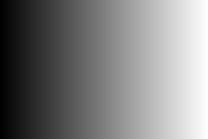

## Exercice 6: Miroir

## Exercice 7: Image bruitée

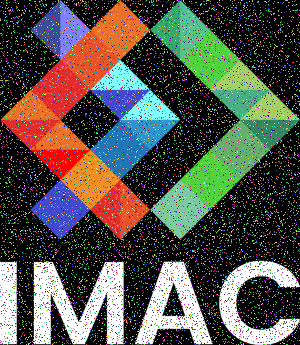

## Exercice 8: Rotation de 90°
### Rotation vers la droite
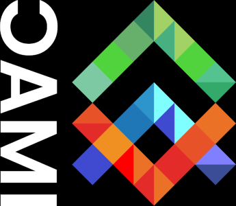
### Rotation vers la gauche
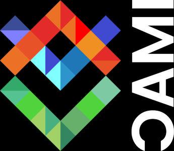

## Exercice 9: RGB split

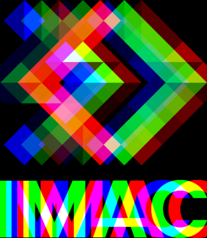

## Exercice 10: luminosité

### Éclaircir

### Assombrir

## Exercice 11: Disque blanc

## Exercice 12: Cercle

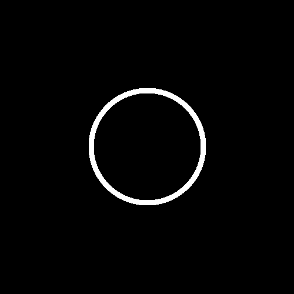

## Exercice 13: Animation

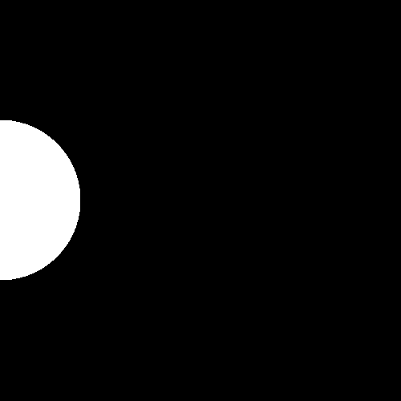
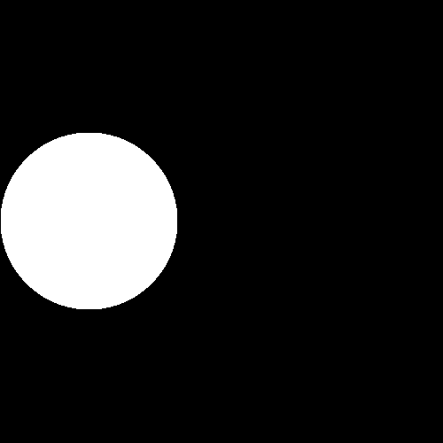
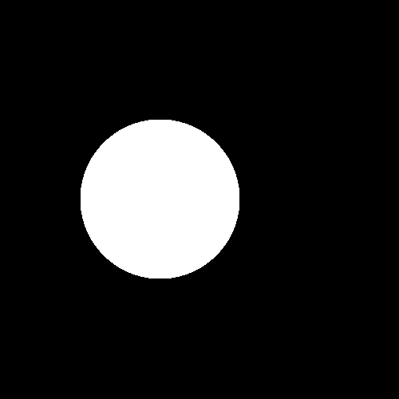
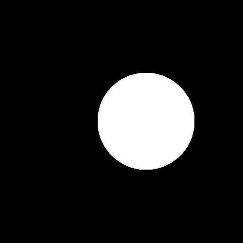
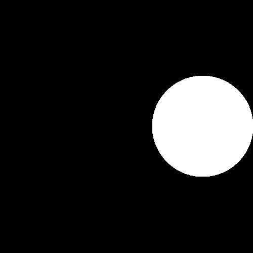

## Exercice 14: Rosace

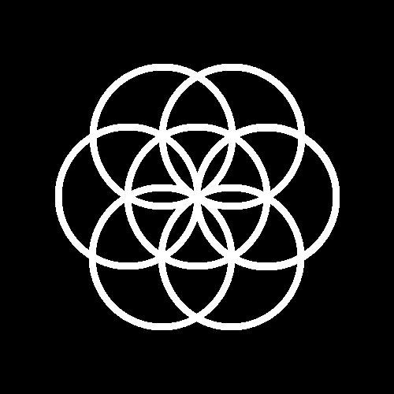

## Exercice 15: Mosaïque

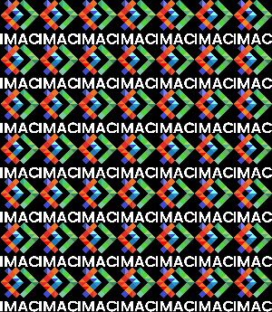

J'ai eu beaucoup de mal avec celui-là parce que je n'utilisais pas % et je tombais tout le temps en dehors de l'image.

## Exercice 16: Mosaïque miroir

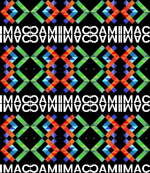

Pour inverser, j'ai fait en sorte d'avoir 2 templates (1 avec le logo normal, 1 avec le logo en miroir). Lorsque le programme finissait 1 ligne du logo, il venait prendre l'autre template. Et lorsque le programme finissait une colonne du logo, il venait renverser les templates. 

## Exercice 17: Glitch

## Exercice 18: Tri de pixel

### Tri de tous les pixels

### Tri des pixels par ligne
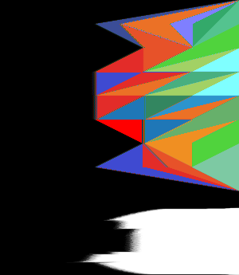
### Tri des pixels de manière aléatoire

Pour le dernier je ne sais pas pourquoi mais le tri ne se fait qu'en bas de l'image. 

## Exercice 19: Fractale de Mandelbrot

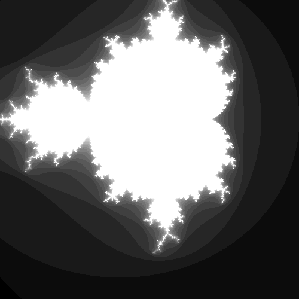

Changement de la formule avec : sqrt(z)*z+c

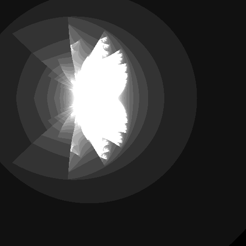

Au début j'avais oublié de mettre mes données en float, ce qui donnait un gros pâté blanc :

## Exercice 20: Dégradés dans l'espace de couleur Lab

### Dégradé de couleur dans sRGB
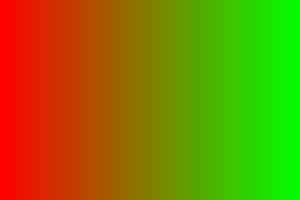
### Dégradé de couleur dans Lab
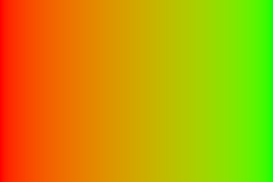

## Exercice 23: Vortex

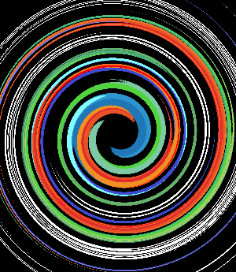

Voici d'autres résultats marrants que j'ai obtenus :

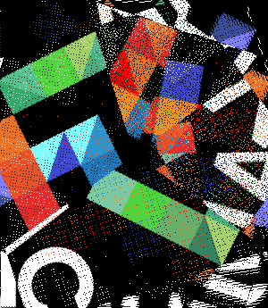

J'ai juste échangé les pixels en fonction de la rotation sans avoir d'images en backup pour accueillir le rendu.

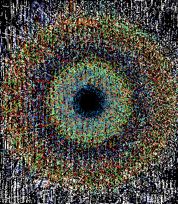

Ici j'ai juste mis l'effet très fort.

## Exercice 24: Convolution

J'ai voulu changer la formule pour faire en sorte que en fonction de la position du pixel sa couleur impacte plus ou moins l'image finale, mais j'ai mal calculé mes divisions et ai obtenu un effet néon à la place :

## Exercice 25: Netteté, Contours, etc.

### Emboss

### Outline
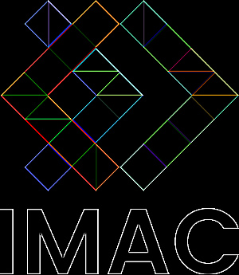
### Sharpen

## Exercice 30: Diamond Square
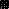

J'ai voulu créer un algorithme qui, qu'importe la taille de la carte, va créer l'image.
Déjà, j'ai commencé par définir les couleurs des coins.
Puis j'ai défini 2 actions différentes à répéter :
- Définir le pixel central
- Définir les pixels sur les côtés

Comme j'ai voulu tout automatiser, j'ai décidé de répéter ces actions dans 3 boucles différentes :
- Une première boucle pour dire à quel niveau de rétrécissement on en est pour l'application du diamant (ex: on a une image qu'on divise en 4 zones égales, puis chacune de ces zones est divisée en 4 zones égales etc.)
- Deux autres boucles pour parcourir les sous-divisions de l'image.

Exemple : 
Nous avons une image. Au premier tour, le programme n'a pas de sous-division et va donc appliquer les actions sur toute l'image. Au second tour, l'image est divisée en quatre : Le programme va alors parcourir les 4 carrés et appliquer les actions dans chacun de ces carrés.
Et ainsi de suite.

J'ai eu beaucoup de difficultés pour celui-là, notamment pour connaître la position des pixels en fonction du niveau de rétrécissement en cours.